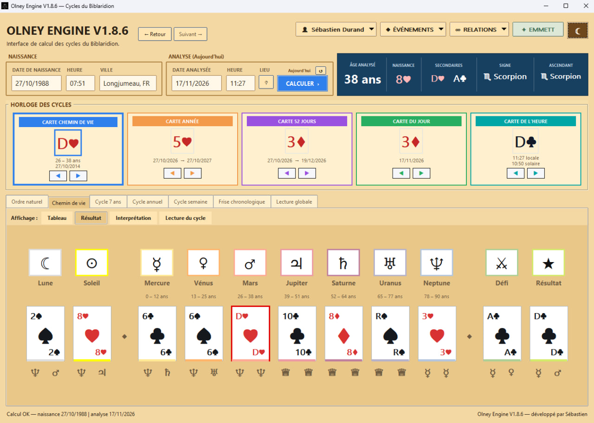
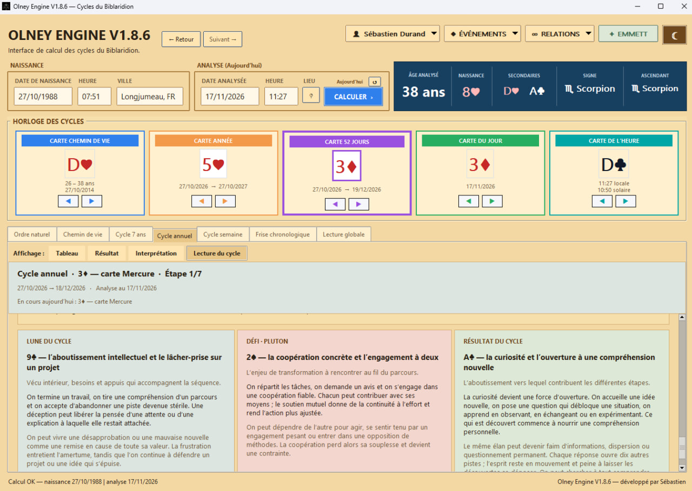
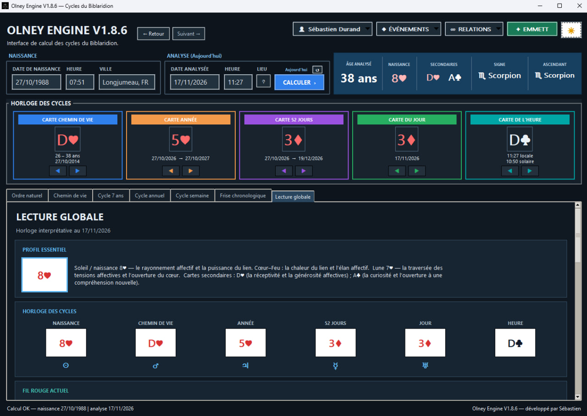

# Olney Engine V1.8.9

[Français](README.md) · [Contributing](CONTRIBUTING.md) · [License scope](LICENSING.md)

## Contents

- [The origins of Olney Engine](#the-origins-of-olney-engine)
- [Download and installation](#installation)
- [Why Olney Engine?](#why)
- [Explore the application](#explore-the-application)
- [Menus, profiles, events and relationships](#menus-profiles-events-and-relationships)
- [Emmett](#emmett)
- [Historical sources and references](#references)
- [Biblaridion and Revelation](#biblaridion)
- [Historical Atlas](#atlas)
- [Frequently asked questions](#faq)
- [Local data](#local-data)
- [Run from source](#run-from-source)
- [Tests and checks](#tests-and-checks)
- [How the engine fits together](#how-the-engine-fits-together)
- [License and project governance](#license-and-project-governance)

<p align="center">
  
</p>

## The origins of Olney Engine

In 1893, **Olney H. Richmond**, an American occultist associated with the Order
of the Magi, published *The Mystic Test Book*, devoted to the symbolic system
known here as the Cartomancy of the Ancient Magi.

Richmond presented his teaching as an ancient esoteric tradition, including
claims of Atlantean origins. His **Religion of the Stars** connects celestial
cycles, numbers and the 52 playing cards through a shared symbolic language.
These origins describe Richmond's beliefs and the system's tradition.

<p align="center">
  
</p>

For Richmond, the deck acts as a cosmic calendar for exploring correspondences
between celestial movements and life events. **Olney Engine revisits this
system in a digital application**, combining its calculations, temporal cycles
and event analysis with interactive exploration.

### The application

A Windows desktop application exploring the **Cartomancy of the Ancient Magi**
and Richmond's 52-card system. Olney combines deterministic card calculations,
interactive timelines, structured interpretations, profiles, events and relationships.
**Emmett** is its optional conversational interface, using OpenAI or OpenRouter.

<a id="installation"></a>

**[Download Windows installer 1.8.9](https://github.com/sebastien88-stack/olney-engine/releases/download/v1.8.9/Olney_Engine_Setup_1.8.9.exe)** · [Portable ZIP](https://github.com/sebastien88-stack/olney-engine/releases/download/v1.8.9/Olney_Engine_Portable_1.8.9.zip) · [Releases](https://github.com/sebastien88-stack/olney-engine/releases)

Python is not required for the installed application. Extract the entire portable
ZIP before launching `Olney Engine.exe`.

<a id="why"></a>
## Why Olney Engine?

Olney brings card calculations, time exploration and lived experience into one
workspace, from detailed tables to global readings and individual periods or
relationships. The project helps people explore how symbolic themes develop across different
time scales. Cards describe energies with many possible expressions, rather
than a fixed sequence of real-world events. The calculation engine determines
cards and periods; interpretation remains a separate, contextual layer.

Development is open to contributions. The maintainer defines the direction and
reviews changes through pull requests. See [CONTRIBUTING.md](CONTRIBUTING.md).

## Explore the application

### Dashboard and cycle clock

Enter birth details and an analysis date to inspect life-path, annual, 52-day,
daily and hourly cards. Navigation keeps the clock and analysis date synchronized.
The Today button returns to the current date and time. Light parchment and dark
themes are available through the sun/moon button.

<p align="center">
  
</p>

### Life path and sequence results

Result views show cards, planetary roles and periods, alongside the Moon, Sun,
Challenge and Result. Each of the seven main life-path cards, from Mercury to
Neptune, spans thirteen years. Click a card to explore the corresponding step.

<p align="center">
  
</p>

### Active-card interpretation

Explore a card's energy, element, sequence role and table position, including
constructive and difficult expressions and examples of possible manifestations.

<p align="center">
  
</p>

### Full-cycle reading

Read the movement of a complete sequence, its seven steps, Moon, Challenge and
Result. A fixed header retains the consulted step and distinguishes it from today.

<p align="center">
  
</p>

### Tables and position exchanges

Tables expose planetary axes, the Crown, fixed and semi-fixed cards, the active
card and the cards involved in its position exchange.

<p align="center">
  
</p>

### Interactive timeline

Zoom and move through layered periods, synchronized with the clock. Markers
highlight Crown passages, double planetary positions and convergences.

<p align="center">
  
</p>

### Global reading

Combine the essential profile, active cards and their resonances, then open a
card for a closer reading.

<p align="center">
  
</p>

## Menus, profiles, events and relationships

Top menus provide access to profiles, events, relationships and Emmett. Recent
lists help reopen dossiers; Back and Forward navigate between consultations.

### Profiles

Save a first name, surname, subject type, birth date, time and place. The profile
page shows signs, ascendants, birth and secondary cards, today's clock and
life-path cards through Challenge and Result. Search, column sorting and favorites
help browse profiles. Names remain visible during horizontal scrolling.

### Events

Create an event from the analysis date, assign it to a profile and associate
registered participants or freely entered names. Categories, dates and notes help
find important moments. The grid displays cycle configurations at each event's date.

### Relationships

A relationship dossier brings two profiles together: birth and secondary cards,
the relationship card and its life path, card correspondences and clocks
synchronized to a common date. The reading distinguishes underlying correspondences
from temporal activations. The meeting date remains an event in the link's history.

### Emmett

Chat about a profile, event, relationship or the method. The engine prepares
calculated context; the model uses it to formulate a reading. Conversations are
saved locally, and a Context panel exposes the prepared reference data.

Open **Emmett → Connexion**, choose OpenAI or OpenRouter, enter your API key and
model identifier. OpenRouter accepts its exact model IDs or `openrouter/auto`.
The UI is currently French. Keys remain in session memory. Messages and useful
context are sent to the chosen service and, with OpenRouter, the routed model
provider. Online generation may incur charges. Offline calculations and built-in
readings do not require an API key.

<a id="references"></a>
## Historical sources and references

These sources document Olney H. Richmond's writings and their historical context:

| Work | Documentary reference |
| --- | --- |
| *Temple Lectures of the Order of the Magi* (1892) | Lectures on the Order's teachings; [digitized edition, IAPSOP (PDF)](https://iapsop.com/ssoc/1892__richmond___temple_lectures_of_the_order_of_the_magi.pdf). |
| *The Mystic Test Book; or, The Magic of the Cards* (1893) | A central work on cards and their correspondences; [1893 copy, Library of Congress](https://www.loc.gov/resource/gdcmassbookdig.mystictestbook01rich/?st=gallery). |
| *Mystic Test Book Supplement* (1896) | Additional instructions on layouts and time cards; [digitized edition, IAPSOP (PDF)](https://iapsop.com/ssoc/1896__richmond___mystic_test_book_supplement.pdf). |
| *Religion of the Stars* | A collection revisiting and expanding the lectures; [contemporary advertisement, *The Progressive Thinker*, June 19, 1897 (PDF, IAPSOP)](https://iapsop.com/archive/materials/progressive_thinker/progressive_thinker_v16_n395_jun_19_1897.pdf). |

These documents record Richmond's teachings and claims. Accounts of Atlantean
origins belong to that esoteric tradition. Editions, editorial additions and
modern resources may carry distinct rights: consultation links do not grant
redistribution permission. Application conventions and corpus sources are
identified in [interpretation provenance](interpretation/provenance.json).

<a id="biblaridion"></a>
### Biblaridion and Revelation

In Revelation, the small scroll — [*biblaridion*](https://biblehub.com/greek/974.htm) —
and the **Seven Thunders**, whose words must not be written down, appear in
[Revelation 10:2–10](https://www.aelf.org/bible/Ap/10).
The scroll with **Seven Seals** appears in [5:1](https://www.aelf.org/bible/Ap/5),
and the **Book of Life** notably in [20:12–15](https://www.aelf.org/bible/Ap/20)
(links to the French biblical text; [English chapter 10](https://bible.usccb.org/bible/revelation/10)).
Connecting these motifs with the 52 cards is an esoteric interpretation;
the biblical text does not set out this cartomancy system.

<a id="atlas"></a>
## Historical Atlas

The **Historical Atlas** is an independent project under construction: a
database intended to gather hundreds of historical figures and dates for
future exploration. Sources, dates, precision and reuse rights still require
verification. The Atlas is not included in the downloadable application or this
repository's datasets. Integration will be handled separately; see [DATA_POLICY.md](DATA_POLICY.md).

<a id="faq"></a>
## Frequently asked questions

**Do I need Python?**

Not for the Windows installer: download the `.exe` above and follow the wizard.
Extract the full portable ZIP before launching it. Python with Tcl/Tk is only
needed to run the source code.

**Is the application free?**

Current downloads are free of charge. Emmett may incur charges from OpenAI or
OpenRouter, depending on the model and account. Code and resource licensing
terms are documented in [LICENSING.md](LICENSING.md).

**What works offline?**

Calculations, tables, the timeline, built-in readings and local dossiers work
offline. Emmett's response generation requires an Internet connection.

**Is Emmett required?**

No. Connect this optional AI interface through **Emmett → Connexion**.
It uses context prepared by the engine; calculations remain accessible without
an API key. The application does not persist the key.

## Local data

Profiles, events, relationships and conversations are stored in a local SQLite
database, created automatically at first launch at
`%LOCALAPPDATA%\Olney Engine\olney_profiles.db`. Personal databases are included
in neither this repository nor the distributed downloads.

## Run from source

The latest published Windows version is **1.8.9**. The `main` branch also contains
development improvements made after that release, which are not yet included in
the downloads. The declared version remains 1.8.9 until a subsequent publication.

Python **3.12** is the tested baseline. Install Python with **Tcl/Tk** and Git.
Windows is the supported desktop target. The runtime uses the Python standard
library plus bundled timezone data; no OpenAI SDK or web server is required.

```bash
git clone https://github.com/sebastien88-stack/olney-engine.git
cd olney-engine
python -m venv .venv
```

Activate the environment in PowerShell:

```powershell
.\.venv\Scripts\Activate.ps1
```

Or in Git Bash:

```bash
source .venv/Scripts/activate
```

```bash
python -m pip install -r requirements-dev.txt
python -c "import tkinter; print(tkinter.TkVersion)"
python app.py
```

The runtime requirements file is intentionally empty. Development requirements
install the test runner. For release builds, follow [build instructions](build_tools/README.md).

### Configuration

All configuration is optional. Keys can also be entered in Emmett's connection dialog.

| Variable | Purpose |
| --- | --- |
| `OPENAI_API_KEY` | OpenAI session key |
| `OLNEY_OPENAI_MODEL` | OpenAI model identifier |
| `OPENROUTER_API_KEY` | OpenRouter session key |
| `OLNEY_OPENROUTER_MODEL` | OpenRouter model identifier |
| `OLNEY_PROFILE_DB` | Override the local SQLite database path, useful for testing |

Environment variables are read directly from the process environment. `.env`
files are **not automatically loaded**. [.env.example](.env.example) documents
names only; do not commit real keys or personal databases.

With no `OLNEY_PROFILE_DB` override, the app creates an empty database at
`%LOCALAPPDATA%\Olney Engine\olney_profiles.db`. Existing personal data is not
bundled. A synthetic input example is supplied in [examples/demo_profile.json](examples/demo_profile.json);
it documents input values and is not an automatic profile importer.

## Tests and checks

Run from the repository root, without API keys:

```bash
python -m pytest tests -q
python tools/check_python.py
python tools/validate_interpretation.py
python tools/audit_public_repository.py
```

On a Windows machine with working Tcl/Tk, also run:

```bash
python tools/ui_startup_smoke.py
```

Tests use synthetic inputs and temporary databases. API requests are mocked.
Pytest includes three real-Tk journeys: startup, card navigation and opening the
chat workspace. Each runs in a separate process with a temporary database and a
90-second timeout, without calling an AI model. Windows with Tcl/Tk is required
for these journeys. Run only UI tests with `python -m pytest tests -q -m ui`, or
exclude them with `python -m pytest tests -q -m "not ui"`.

CI runs two Windows/Python 3.12 jobs: **Windows Python 3.12 checks** (general
checks and isolated startup) and **Windows Tk UI journeys** (pytest UI journeys).
Both jobs affect workflow success. CI neither builds nor publishes releases
and uses no private API keys.

The application version is defined only in `version.py`. Runtime code, tests and
Windows build metadata derive from it. README files, history and release notes
are maintained separately at publication time.

## How the engine fits together

`OlneyEngine.full_state()` calculates card states for a birth date and analysis
date using the 90 canonical series in `data.json`. Calendar and hourly helpers
resolve periods and local/solar-time information. The interpretation layer adds
card descriptions, planetary roles and hierarchical cycle context. Emmett
receives that prepared context and does not recalculate card positions.

| Location | Responsibility |
| --- | --- |
| `app.py`, `*_ui.py`, `brand_theme.py` | Tkinter/ttk desktop interface |
| `olney_engine.py`, `hour_card.py`, `astro_engine.py` | Deterministic calculations |
| `timeline_runtime.py`, `cycle_reading.py` | Time exploration and cycle readings |
| `interpretation/`, `interpretation_runtime.py` | Structured corpus and interpretation context |
| `relationship_runtime.py`, `reading_service.py` | Relationship and subject dossiers |
| `*_store.py` | SQLite persistence |
| `olney_chat.py`, `chat_ui.py` | Emmett and provider connections |
| `tests/`, `tools/` | Regression tests, checks and utilities |
| `build_tools/` | Windows packaging |

The [Historical Atlas](#atlas) is a separate project under construction;
its data and any future schema changes are outside the current application.

## License and project governance
Developed by Sébastien. Olney Engine explores the Cartomancy of the Ancient Magi,
with rules and readings documented in its interpretation corpus.

Original project code is offered under [GNU GPL v3.0](LICENSE). Third-party data
and resources have separate terms; see [license scope and pending checks](LICENSING.md).
Third-party components are documented in [THIRD_PARTY_NOTICES.md](THIRD_PARTY_NOTICES.md).

- [Contributing](CONTRIBUTING.md) · [Code of conduct](CODE_OF_CONDUCT.md)
- [Windows build instructions](build_tools/README.md)
- [Backend documentation](BACKEND_LECTURE.md) · [Interpretation corpus](interpretation/README.md)
- [Version 1.8.9 notes](RELEASE_NOTES_1.8.9.md) · [Version history](docs/HISTORY.md)
- [Security reports](SECURITY.md) · [Audit report](docs/OPEN_SOURCE_AUDIT.md)
- [Maintainer setup](docs/GITHUB_SETUP.md)
