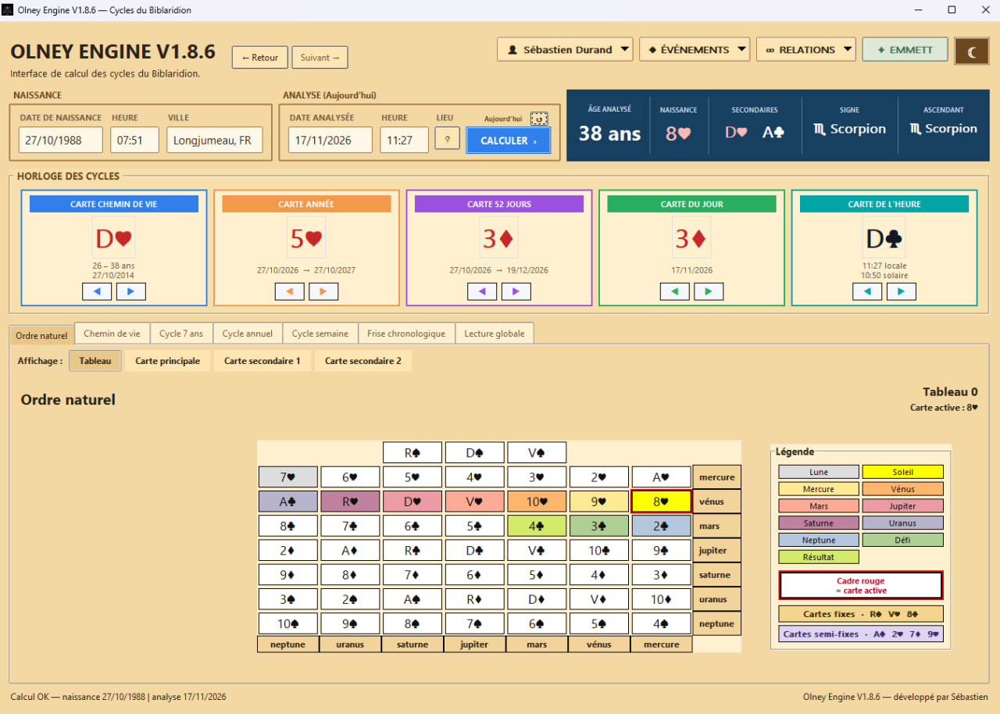
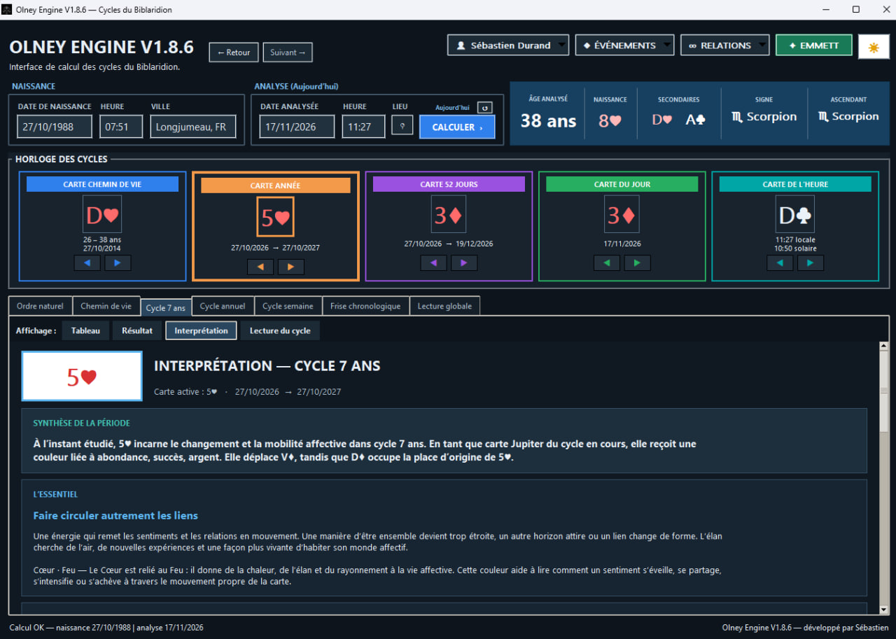
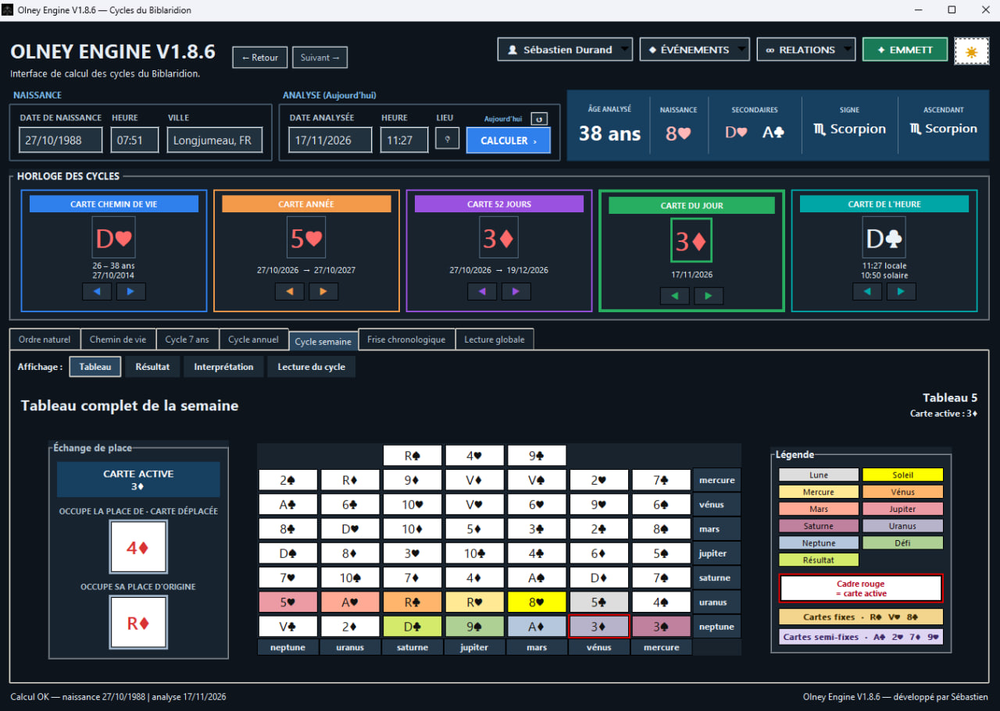
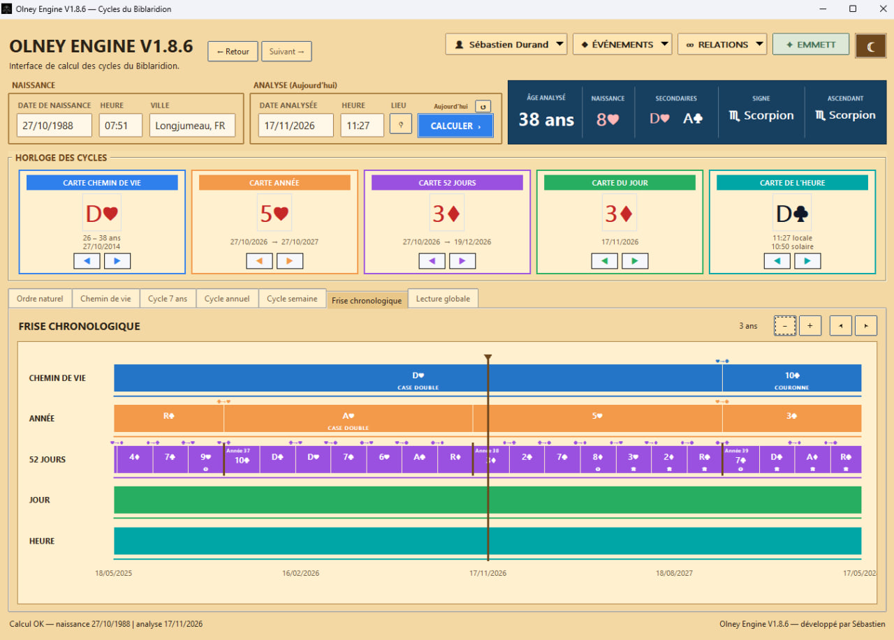

# Olney Engine

[Français](README.md) · [Contributing](CONTRIBUTING.md) · [License scope](LICENSING.md)

<p align="center">
  
</p>

## The origins of Olney Engine

In 1893, **Olney H. Richmond**, an American occultist associated with the Order
of the Magi, published *The Mystic Test Book*, devoted to the symbolic system
known here as the Cartomancy of the Ancient Magi.

Richmond presented his teaching as an ancient esoteric tradition, including
claims of Atlantean origins. His **Religion of the Stars** connects celestial
cycles, numbers and the 52 playing cards through a shared symbolic language.
These origins describe Richmond's beliefs and the system's tradition.

<p align="center">
  
</p>

For Richmond, the deck acts as a cosmic calendar for exploring correspondences
between celestial movements and life events. **Olney Engine revisits this
system in a digital application**, combining its calculations, temporal cycles
and event analysis with interactive exploration.

### The application

A Windows desktop application exploring the **Cartomancy of the Ancient Magi**
and Richmond's 52-card system. Olney combines deterministic card calculations,
interactive timelines, structured interpretations, profiles, events and relationships.
**Emmett** is its optional conversational interface, using OpenAI or OpenRouter.

**[Download Windows installer 1.8.6](https://github.com/sebastien88-stack/olney-engine/releases/download/v1.8.6/Olney_Engine_Setup_1.8.6.exe)** · [Portable ZIP](https://github.com/sebastien88-stack/olney-engine/releases/download/v1.8.6/Olney_Engine_Portable_1.8.6.zip) · [Releases](https://github.com/sebastien88-stack/olney-engine/releases)

The published 1.8.6 binaries predate this community/licensing preparation and
retain their original licensing notices. This branch does not publish new binaries.

## Purpose and approach

The project helps people explore how symbolic themes develop across different
time scales. Cards describe energies with many possible expressions, rather
than a fixed sequence of real-world events. The calculation engine determines
cards and periods; interpretation remains a separate, contextual layer.

Development is open to contributions. The maintainer defines the direction and
reviews changes through pull requests. See [CONTRIBUTING.md](CONTRIBUTING.md).

## Explore the application

### Dashboard and cycle clock

Enter birth details and an analysis date to inspect life-path, annual, 52-day,
daily and hourly cards. Navigation keeps the clock and analysis date synchronized.
Light parchment and dark themes are available.



### Life path and sequence results

Result views show cards, planetary roles and periods, alongside the Moon, Sun,
Challenge and Result. Each of the seven main life-path cards spans thirteen years.


### Active-card interpretation

Explore a card's energy, element, sequence role and table position, including
constructive and difficult expressions and examples of possible manifestations.



### Full-cycle reading

Read the movement of a complete sequence, its seven steps, Moon, Challenge and
Result. A fixed header retains the consulted step and distinguishes it from today.


### Tables and position exchanges

Tables expose planetary axes, the Crown, fixed and semi-fixed cards, the active
card and the cards involved in its position exchange.



### Interactive timeline

Zoom and move through layered periods, synchronized with the clock. Markers
highlight Crown passages, double planetary positions and convergences.



### Global reading

Combine the essential profile, active cards and their resonances, then open a
card for a closer reading.


### Menus, profiles, events and relationships

Top menus offer recent dossiers, full lists and creation actions. Profiles include
birth details, signs, ascendants, secondary cards, today's clock and life-path
cards. Search, column sorting and favorites help browse them.

Events associate dates, categories, notes and participants with profiles; their
grid displays cycle configurations at the event date. Relationship dossiers
compare birth cards, secondary cards, permanent correspondences and synchronized
clocks, and include a relationship card and its life path.

### Emmett

Chat about a profile, event, relationship or the method. The engine prepares
calculated context; the model uses it to formulate a reading. Conversations are
saved locally, and a Context panel exposes the prepared reference data.

Open **Emmett → Connexion**, choose OpenAI or OpenRouter, enter your API key and
model identifier. OpenRouter accepts its exact model IDs or `openrouter/auto`.
The UI is currently French. Keys remain in session memory. Messages and useful
context are sent to the chosen service and, with OpenRouter, the routed model
provider. Online generation may incur charges. Offline calculations and built-in
readings do not require an API key.

## Run from source

Python **3.12** is the tested baseline. Install Python with **Tcl/Tk** and Git.
Windows is the supported desktop target. The runtime uses the Python standard
library plus bundled timezone data; no OpenAI SDK or web server is required.

```bash
git clone https://github.com/sebastien88-stack/olney-engine.git
cd olney-engine
python -m venv .venv
```

Activate the environment in PowerShell:

```powershell
.\.venv\Scripts\Activate.ps1
```

Or in Git Bash:

```bash
source .venv/Scripts/activate
```

```bash
python -m pip install -r requirements-dev.txt
python -c "import tkinter; print(tkinter.TkVersion)"
python app.py
```

The runtime requirements file is intentionally empty. Development requirements
install the test runner. For release builds, follow [build instructions](build_tools/README.md).

### Configuration

All configuration is optional. Keys can also be entered in Emmett's connection dialog.

| Variable | Purpose |
| --- | --- |
| `OPENAI_API_KEY` | OpenAI session key |
| `OLNEY_OPENAI_MODEL` | OpenAI model identifier |
| `OPENROUTER_API_KEY` | OpenRouter session key |
| `OLNEY_OPENROUTER_MODEL` | OpenRouter model identifier |
| `OLNEY_PROFILE_DB` | Override the local SQLite database path, useful for testing |

Environment variables are read directly from the process environment. `.env`
files are **not automatically loaded**. [.env.example](.env.example) documents
names only; do not commit real keys or personal databases.

With no `OLNEY_PROFILE_DB` override, the app creates an empty database at
`%LOCALAPPDATA%\Olney Engine\olney_profiles.db`. Existing personal data is not
bundled. A synthetic input example is supplied in [examples/demo_profile.json](examples/demo_profile.json);
it documents input values and is not an automatic profile importer.

## Tests and checks

Run from the repository root, without API keys:

```bash
python -m pytest tests -q
python tools/check_python.py
python tools/validate_interpretation.py
python tools/audit_public_repository.py
```

On a Windows machine with working Tcl/Tk, also run:

```bash
python tools/ui_startup_smoke.py
```

Tests use synthetic inputs and temporary databases. API requests are mocked.
CI runs tests, syntax compilation, corpus validation and isolated UI startup on
Windows/Python 3.12; it does not publish a release or use private API keys.

## How the engine fits together

`OlneyEngine.full_state()` calculates card states for a birth date and analysis
date using the 90 canonical series in `data.json`. Calendar and hourly helpers
resolve periods and local/solar-time information. The interpretation layer adds
card descriptions, planetary roles and hierarchical cycle context. Emmett
receives that prepared context and does not recalculate card positions.

| Location | Responsibility |
| --- | --- |
| `app.py`, `*_ui.py`, `brand_theme.py` | Tkinter/ttk desktop interface |
| `olney_engine.py`, `hour_card.py`, `astro_engine.py` | Deterministic calculations |
| `timeline_runtime.py`, `cycle_reading.py` | Time exploration and cycle readings |
| `interpretation/`, `interpretation_runtime.py` | Structured corpus and interpretation context |
| `relationship_runtime.py`, `reading_service.py` | Relationship and subject dossiers |
| `*_store.py` | SQLite persistence |
| `olney_chat.py`, `chat_ui.py` | Emmett and provider connections |
| `tests/`, `tools/` | Regression tests, checks and utilities |
| `build_tools/` | Windows packaging |

The future **Historical Atlas** is external to this task. No Atlas dataset or
schema migration is introduced. [DATA_POLICY.md](DATA_POLICY.md) defines the boundary.

## License and project governance

Original project code is proposed under **GNU GPL v3.0 only**; see [LICENSE](LICENSE)
and [LICENSING.md](LICENSING.md) for the exact scope. GPL-compatible commercial use
is permitted subject to the license obligations. Third-party data retain their
own licenses. Workbook-derived series, book-derived content and selected artwork
have outstanding provenance checks; **this is not a claim that every bundled
resource is cleared for open-source redistribution**.

See [CONTRIBUTING.md](CONTRIBUTING.md), [CODE_OF_CONDUCT.md](CODE_OF_CONDUCT.md),
[SECURITY.md](SECURITY.md), [third-party notices](THIRD_PARTY_NOTICES.md),
[audit report](docs/OPEN_SOURCE_AUDIT.md) and [maintainer setup](docs/GITHUB_SETUP.md).

Developed by Sébastien. [Backend documentation](BACKEND_LECTURE.md) ·
[Version history](docs/HISTORY.md) · [Release notes](RELEASE_NOTES_1.8.6.md).
