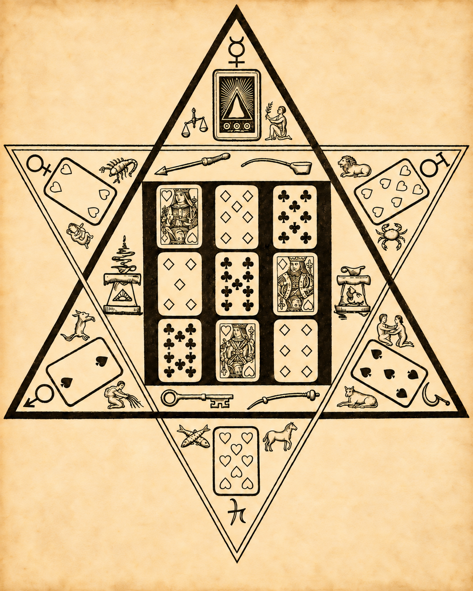
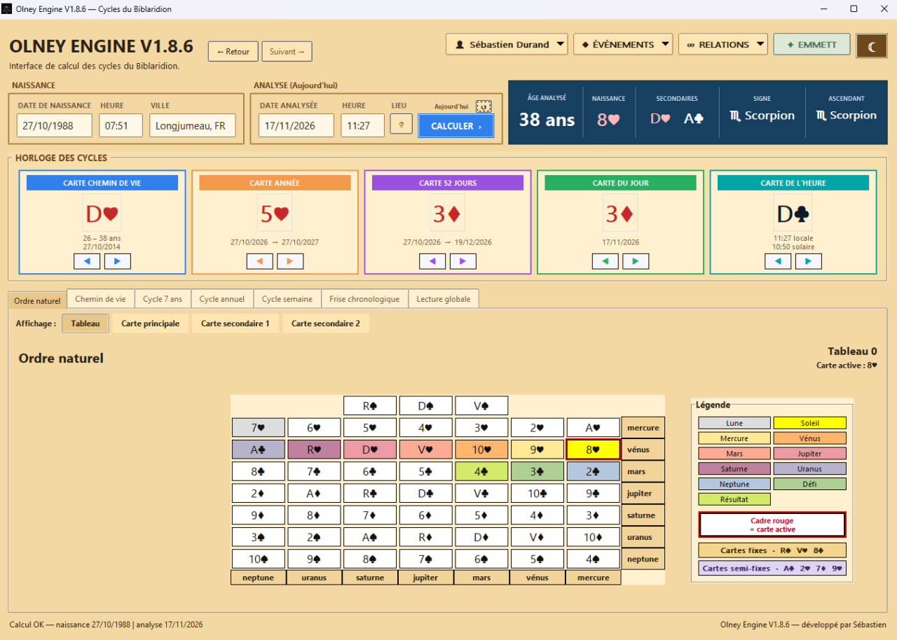
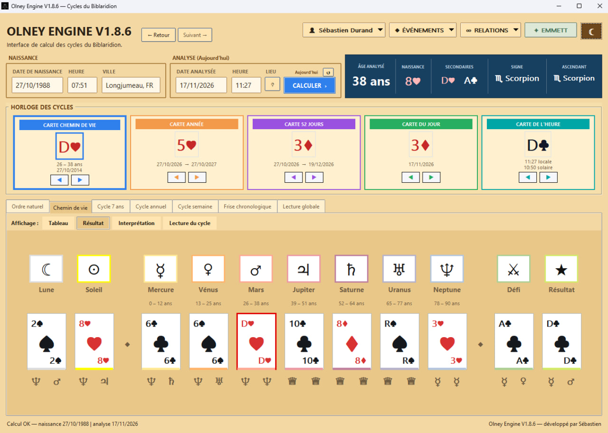
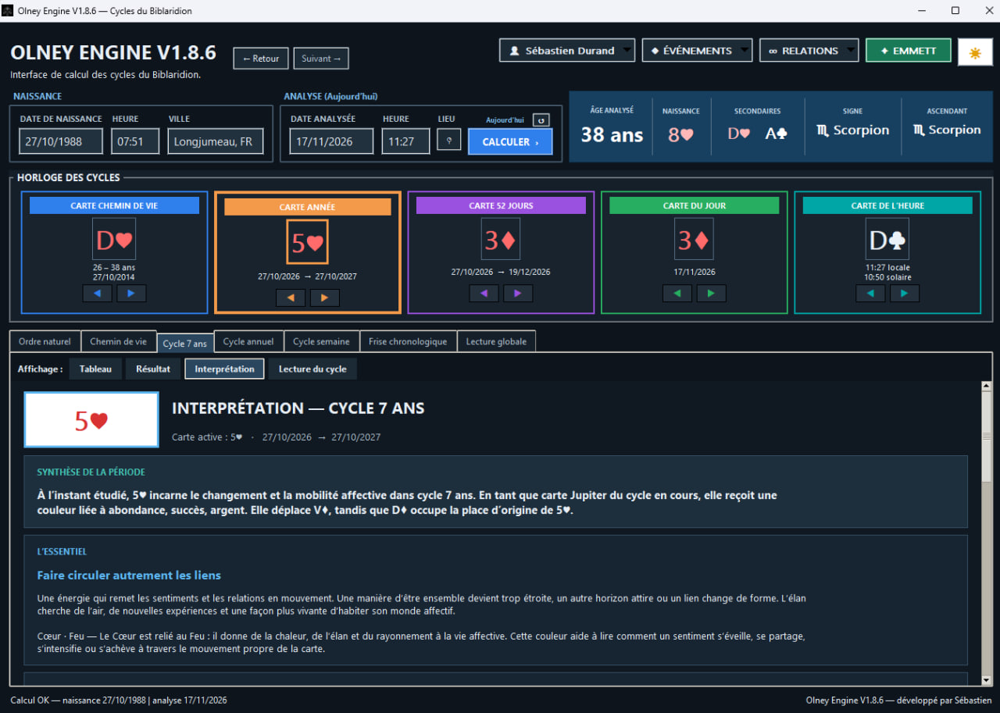
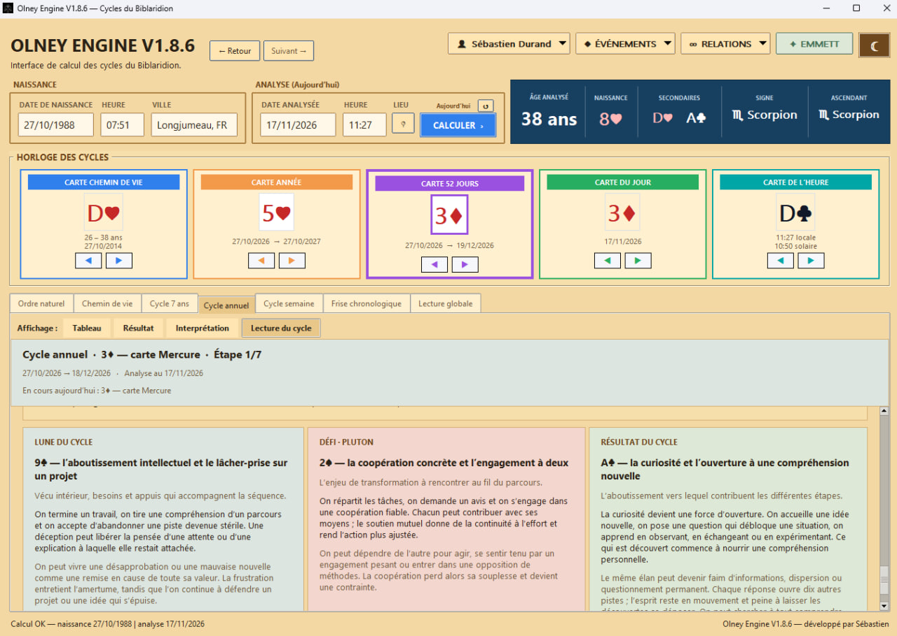
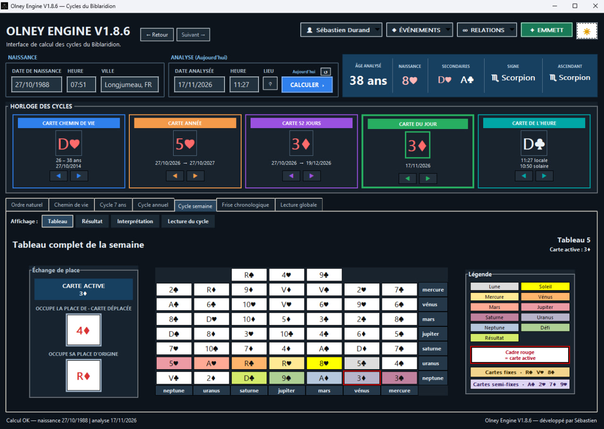
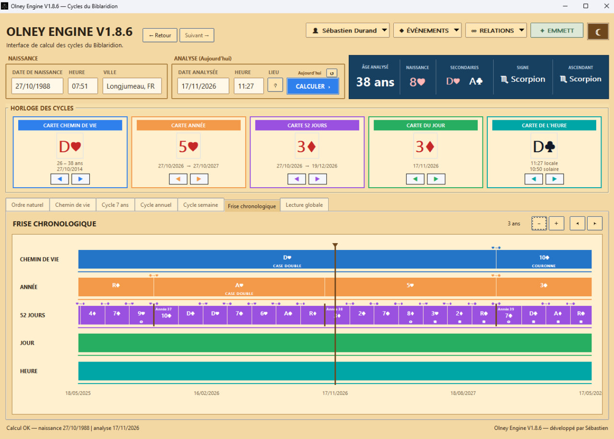
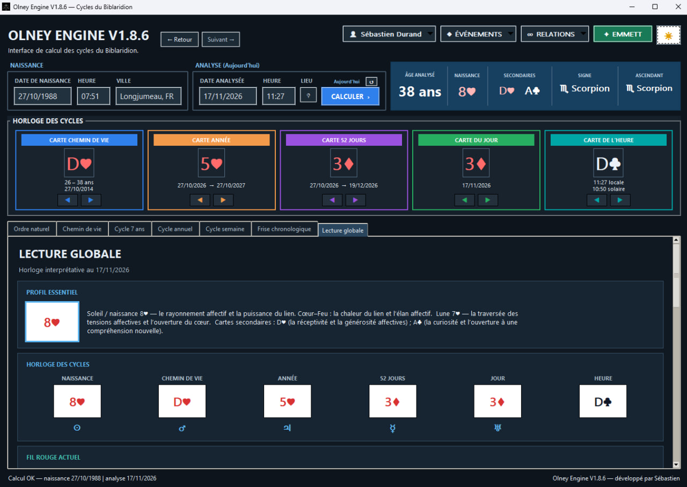

# Olney Engine — V1.8.6

<p align="center">
  
</p>

## Aux origines d'Olney Engine

À la fin du XIXe siècle, **Olney H. Richmond**, occultiste américain et représentant de l'Ordre des Mages, publie en 1893 *The Mystic Test Book*, un ouvrage consacré à **la cartomancie des anciens Mages**.

Richmond affirme être l'héritier d'une tradition ésotérique millénaire, issue notamment des atlantes. Au cœur de son enseignement se trouve **la Religion des Étoiles**, une conception mystique de l'univers dans laquelle les cycles célestes, les nombres et les 52 cartes à jouer participent d'un même langage symbolique.

<p align="center">
  
</p>

Selon Richmond, le jeu de cartes constitue un véritable calendrier cosmique, permettant d'explorer les correspondances entre les mouvements des astres et les événements de l'existence.

**Olney Engine propose de redécouvrir ce système à l'ère numérique**, en réunissant les calculs de Richmond, les cycles temporels et l'analyse des événements dans une application interactive.

### Olney Engine

Olney Engine est une application Windows consacrée au système des 52 cartes.
Elle réunit les cartes de naissance, les cycles temporels, une frise interactive,
les événements, les relations et Emmett, un interlocuteur IA qui s’appuie sur
les calculs et les règles du moteur pour accompagner la lecture.

**[Télécharger Olney Engine 1.8.6 pour Windows (.exe)](https://github.com/sebastien88-stack/olney-engine/releases/download/v1.8.6/Olney_Engine_Setup_1.8.6.exe)**

[Version portable (.zip)](https://github.com/sebastien88-stack/olney-engine/releases/download/v1.8.6/Olney_Engine_Portable_1.8.6.zip) · [Toutes les versions](https://github.com/sebastien88-stack/olney-engine/releases)

Python n’est pas nécessaire pour utiliser l’application installée. La version
portable doit être entièrement extraite avant de lancer `Olney Engine.exe`.

## Découvrir l’application

### Une horloge pour se situer

La date de naissance, l’heure et le lieu servent de point de départ à l’analyse.
L’horloge affiche les cartes actives du chemin de vie, de l’année, des 52 jours,
du jour et de l’heure. Ses flèches permettent d’explorer d’autres périodes ;
la date analysée et les vues se mettent à jour ensemble. Le bouton Aujourd’hui
ramène à la date et à l’heure présentes.



*Le thème clair reprend une palette parchemin. Le bouton soleil/lune permet
de passer au thème sombre, visible dans les captures suivantes.*

### Le chemin de vie et les séquences de cartes

La vue **Résultat** rassemble les cartes d’une séquence, leurs fonctions
planétaires et leurs périodes, avec la Lune, le Soleil, le Défi et le Résultat.
Sur le chemin de vie, les sept étapes de Mercure à Neptune couvrent chacune
treize ans. Un clic sur une carte permet d’approfondir l’étape correspondante.



### Comprendre la carte active

La vue **Interprétation** développe l’énergie de la carte consultée : son
essentiel, son élément, sa fonction dans la séquence et son emplacement dans
le tableau. Elle présente des expressions constructives et difficiles ainsi
que différentes formes possibles dans la vie concrète.



*Les cartes sont lues comme des énergies que l’on traverse et incarne, dont
les manifestations dépendent de la personne, de son contexte et de ses choix.*

### Lire un cycle dans son ensemble

La **Lecture du cycle** replace chaque étape dans le mouvement de la séquence.
Elle articule les sept cartes, la Lune du cycle, le Défi et le Résultat. Un
bandeau fixe conserve les repères de l’étape consultée pendant le défilement,
en distinguant la date explorée de la période réellement en cours aujourd’hui.



### Explorer les tableaux et les échanges de place

Les vues **Tableau** montrent la position des 52 cartes, les axes planétaires,
la Couronne et les cartes fixes ou semi-fixes. La carte active est encadrée ;
le panneau d’échange permet de repérer la carte déplacée et celle qui occupe
sa place d’origine à l’échelle consultée.



### Parcourir la frise chronologique

La frise superpose les cartes du chemin de vie, de l’année, des 52 jours,
du jour et de l’heure. Le zoom révèle progressivement les périodes fines.
La navigation temporelle est synchronisée avec l’horloge ; des repères signalent
notamment les passages en Couronne, les cases doubles et les convergences.



### Relier les différentes échelles

La **Lecture globale** réunit le profil essentiel et les cartes actives pour
faire ressortir le fil rouge du moment, la cascade des cycles et leurs résonances.
Elle permet de passer d’une vue d’ensemble à l’interprétation d’une carte.



## Les menus et les dossiers personnels

Les menus en haut de l’application donnent accès aux **profils**, aux
**événements**, aux **relations** et à **Emmett**. Les listes récentes permettent
de retrouver rapidement un dossier ; les boutons Retour et Suivant facilitent
la navigation entre les consultations.

### Profils

Enregistrez un prénom, un nom, un type de sujet, une date de naissance, une heure
et un lieu. La page des profils rassemble le signe, l’ascendant, les cartes de
naissance et secondaires, l’horloge d’aujourd’hui et les cartes du chemin de vie,
jusqu’au Défi et au Résultat. Recherche, tri par colonne et favoris facilitent
la consultation. Les noms restent visibles pendant le défilement horizontal.

### Événements

Créez un événement à partir de la date analysée, attribuez-le à un profil et
associez des participants enregistrés ou des personnes mentionnées librement.
Les catégories, dates et notes permettent de retrouver les moments importants.
La grille affiche la configuration des cycles à la date de chaque événement,
pour mettre le vécu et les périodes en perspective.

### Relations

Un dossier de relation rapproche deux profils autour de leur lien : cartes de
naissance et secondaires, carte de la relation, chemin de vie du lien,
correspondances entre les cartes et horloges synchronisées à une date commune.
La lecture distingue les correspondances de fond des activations temporelles.
La date de rencontre reste un événement de l’histoire du lien.

### Emmett, l’interlocuteur d’Olney Engine

Emmett permet de discuter d’un profil, d’un événement, d’une relation ou de la
méthode. Le moteur prépare les cartes, les cycles et les règles utiles ; le
modèle les utilise pour formuler une lecture en langage naturel. Les discussions
sont enregistrées localement et peuvent être reprises. Le panneau Contexte
permet de consulter les données préparées pour le modèle.

Pour commencer : **Emmett → Connexion → OpenRouter ou OpenAI**, puis saisir
une clé API et le modèle souhaité. Sur OpenRouter, utiliser l’identifiant exact
du modèle, ou `openrouter/auto` pour le routage automatique.

La clé reste en mémoire pendant la session. Les messages et le contexte utile
sont transmis au service choisi et, avec OpenRouter, au fournisseur du modèle.
L’utilisation du modèle nécessite une connexion Internet et peut être facturée
par le service. Les calculs et les lectures intégrées restent accessibles sans IA.

## Données locales

Les profils, événements, relations et conversations sont conservés dans une
base SQLite locale, créée automatiquement au premier lancement dans
`%LOCALAPPDATA%\Olney Engine\olney_profiles.db`. La base personnelle n’est
incluse ni dans ce dépôt ni dans les fichiers distribués.

## Développement et documentation

Les sources Python et l’application Windows publiée correspondent à la
version **1.8.6**. Pour lancer les sources, utiliser Python avec Tkinter :

```bash
python app.py
```

- [Construction de l’application Windows](build_tools/README.md)
- [Architecture du backend et préparation des lectures](BACKEND_LECTURE.md)
- [Corpus et règles d’interprétation](interpretation/README.md)
- [Nouveautés de la version 1.8.6](RELEASE_NOTES_1.8.6.md)
- [Historique détaillé et documentation des versions précédentes](docs/HISTORY.md)
- [Confidentialité et signalement de problèmes](SECURITY.md)

## Crédits et licence

Développé par Sébastien. Olney Engine explore la cartomancie des anciens mages,
avec des règles et des lectures documentées dans son corpus d’interprétation.

[Licence propriétaire — tous droits réservés](LICENSE.txt).
Les composants tiers sont documentés dans [THIRD_PARTY_NOTICES.md](THIRD_PARTY_NOTICES.md).
